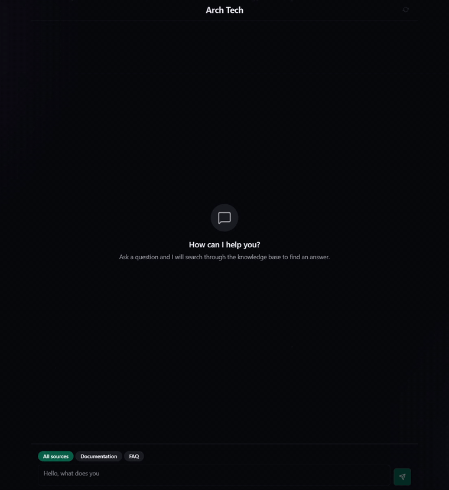
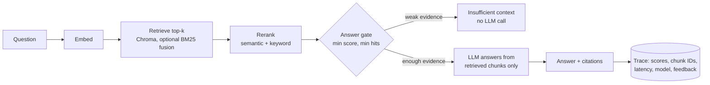

# Customer Support RAG

[](https://github.com/0xrezan/customer-support-rag/actions/workflows/ci.yml)


[](LICENSE)

A support bot that answers **only from your company documents**, cites the source of every answer, and says "not in the knowledge base" instead of guessing. Web chat, Telegram bot, and an admin dashboard for managing the knowledge base.

<p align="center">
  
</p>

## Evaluation

Measured with [`evals/run_eval.py`](evals/run_eval.py) on the bundled knowledge base (3 documents, Russian and English) and 32 questions: 24 answerable, 8 that the documents do not cover. It runs the production `QueryService` end to end; only persistence is stubbed.

| Metric | Result |
|---|---|
| Answer accuracy (required facts present) | **95.8%** (23/24) |
| Citations point to the right document | **100%** |
| Out-of-scope questions declined, not invented | **100%** (8/8) |
| Needed fact present in retrieved chunks (top-5) | 95.8% |
| Latency p50 / p95 | 1.3 s / 1.6 s |

`gpt-5.4-mini`, `text-embedding-3-small`. Full per-question output: [`evals/results/latest.json`](evals/results/latest.json). The one miss is a cross-language retrieval gap: an English question about the support email does not retrieve the Russian chunk that lists it.

```bash
OPENAI_API_KEY=... python -m evals.run_eval           # dense retrieval + rerank (default)
OPENAI_API_KEY=... python -m evals.run_eval --hybrid  # dense + BM25 fusion
```

## How It Works



Documents go through the same path in reverse: upload → background worker parses (PDF, Markdown, text, OCR fallback) → chunks → embeddings → versioned chunks in Chroma.

**Where to look**
- `app/domain/policies/`: the deterministic rules that keep the LLM grounded (retrieval threshold, answer gate, reranking, chunking).
- `app/domain/services/query_service.py`: the question-answering pipeline.
- `app/domain/services/ingestion_service.py`: parsing, chunking, and indexing.
- `frontend/src/features/`: chat and admin workflows.
- [`docs/demo.md`](docs/demo.md): a 5-minute walkthrough with sample questions.

---

## Features

**RAG Pipeline**
- PDF, Markdown, and plain text document ingestion with automatic chunking
- OpenAI embeddings (text-embedding-3-small, 1536d) stored in ChromaDB
- Hybrid retrieval: dense vector search + optional BM25 keyword search with Reciprocal Rank Fusion
- Reranking: weighted semantic similarity (70%) + keyword overlap (30%)
- Answer policy gating: minimum score threshold, minimum hit count -- returns "insufficient context" instead of hallucinating
- Citation extraction with document name and page number
- Jinja2 prompt templates with SQL-based prompt versioning

**LLM Integration**
- Dual provider support: OpenAI and Anthropic (configurable)
- Structured grounding rules -- answers only from retrieved context
- Answer caching in Redis (SHA-256 question hash, configurable TTL)

**Telegram Bot**
- Commands: `/start`, `/help`, `/ask`, `/upload`, `/reindex`, `/delete`, `/status`
- Admin-restricted commands via Telegram user ID allowlist
- Polling and webhook modes
- Formatted responses with citations

**Web Frontend (React SPA)**
- Real-time chat interface with typing indicators and auto-scroll
- Source selector (All sources / Documentation / FAQ)
- Thumbs up/down feedback with optional comment modal
- Retry button on failed messages
- Admin dashboard: document table with sorting, search, status filter, URL-synced params
- Upload dropzone with progress, reindex/delete with confirmation dialogs
- Dark mode (light/dark/system) with persisted preference
- Toast notifications for all operations
- Ambient visual effects: purple glow, floating particles, emerald gradient buttons

**Admin & Security**
- Bearer token auth with constant-time comparison (hmac)
- RBAC system (super_admin, admin, operator, viewer)
- Per-IP rate limiting via Redis sliding window
- Security headers middleware (nosniff, DENY framing, XSS protection)
- Input validation via Pydantic schemas
- Secrets managed through pydantic SecretStr -- never logged

**Background Processing**
- Dramatiq task queue with Redis broker
- Document ingestion, reindexing, soft-delete, reconciliation, chat cleanup tasks
- Configurable retries with exponential backoff
- Row-level locking during ingestion to prevent concurrent processing
- Stale message recovery on startup

**Observability**
- Structured logging via structlog with correlation IDs
- Every answer persisted with retrieval scores, chunk IDs, citations, latency, model info
- Telemetry metrics: query latency, ingestion duration, feedback events
- Health probes: liveness (fast) + readiness (checks DB, Redis, Chroma)

---

## Tech Stack

| Layer | Technology |
|-------|-----------|
| API | FastAPI, Uvicorn |
| Bot | aiogram 3 |
| Frontend | React 19, TypeScript, Vite, Tailwind CSS 4 |
| Database | PostgreSQL 16, SQLAlchemy 2.0 (async), Alembic |
| Vector Store | ChromaDB 0.6 |
| Cache / Broker | Redis 7 |
| Task Queue | Dramatiq |
| LLM | OpenAI API, Anthropic API |
| Embeddings | OpenAI text-embedding-3-small |
| PDF Parsing | pypdf |
| Templating | Jinja2 |
| Logging | structlog |
| Validation | Pydantic 2, Zod (frontend) |
| Testing | pytest, Vitest, Testing Library, MSW |
| Containerization | Docker, Docker Compose |

---

## Architecture

```
app/
  api/              Routes (thin transport layer)
  schemas/          Pydantic request/response models
  domain/
    entities/       Domain entities (Document, Chat, KnowledgeBase)
    value_objects/  Immutable VOs (AnswerResult, Citation, ChunkMetadata)
    policies/       Pure business rules (Chunking, Retrieval, Answer, Reranking)
    services/       Orchestration (QueryService, IngestionService, UploadService)
  infrastructure/   External adapters (DB, Redis, Chroma, LLM, Queue)
  security/         Auth, RBAC, rate limiting
  bot/              Telegram bot routers and middleware
  prompts/          Jinja2 prompt templates

frontend/
  src/
    app/            Providers, router, styles
    pages/          Chat page, Admin page
    features/       Chat, Documents, Health, Metrics, Auth (feature-sliced)
    shared/         UI primitives, API client, hooks, utilities
```

---

## Quick Start

### Prerequisites

- Docker and Docker Compose
- uv
- Node.js 18+ and npm
- Python 3.11+

### 1. Clone and configure

```bash
git clone https://github.com/0xrezan/customer-support-rag.git
cd customer-support-rag
cp .env.example .env
# Add your OpenAI key. Telegram is optional.
```

### 2. Install backend dependencies

```bash
uv sync --extra dev
```

### 3. Start infrastructure

```bash
docker compose up -d postgres redis chroma
```

If local ports are already taken, override the host-side bindings:

```bash
POSTGRES_HOST_PORT=15432 REDIS_HOST_PORT=16379 CHROMA_HOST_PORT=18100 docker compose up -d postgres redis chroma
```

### 4. Run database migrations

```bash
uv run alembic upgrade head
```

### 5. Install frontend dependencies

```bash
cd frontend && npm install && cd ..
```

### 6. Start everything

```bash
uv run python run.py
```

This starts the API (port 8000), Dramatiq worker, and frontend dev server (port 5173) in one command. The Telegram bot is started only when `TELEGRAM_BOT_TOKEN` is configured.

### 7. Open in browser

| Page | URL |
|------|-----|
| Chat | http://localhost:5173 |
| Admin | http://localhost:5173/admin |
| API docs | http://localhost:8000/docs |
| Health check | http://localhost:8000/api/v1/health/live |

Admin token is set in `.env` as `ADMIN_API_TOKEN`.

---

## API Endpoints

| Method | Path | Auth | Description |
|--------|------|------|-------------|
| GET | `/api/v1/health/live` | -- | Liveness probe |
| GET | `/api/v1/health/ready` | -- | Readiness probe (DB, Redis, Chroma) |
| POST | `/api/v1/chat/ask` | -- | Ask a question, get RAG answer + citations |
| POST | `/api/v1/feedback/submit` | -- | Submit thumbs up/down feedback |
| POST | `/api/v1/admin/documents/upload` | Bearer | Upload document for ingestion |
| GET | `/api/v1/admin/documents` | Bearer | List all documents |
| GET | `/api/v1/admin/documents/{id}` | Bearer | Get document status |
| POST | `/api/v1/admin/documents/{id}/reindex` | Bearer | Trigger reindexing |
| DELETE | `/api/v1/admin/documents/{id}` | Bearer | Soft/hard delete |
| POST | `/api/v1/admin/bulk/upload` | Bearer | Bulk upload |
| POST | `/api/v1/admin/bulk/reindex` | Bearer | Reindex all documents |

---

## Database Schema

8 tables: `documents`, `ingestion_jobs`, `chat_questions`, `chat_answers`, `feedback_events`, `prompt_versions`, `knowledge_bases`, `admin_users`

Managed via Alembic migrations in `migrations/versions/`.

---

## Testing

```bash
# Backend
uv run pytest -q
uv run ruff check .

# Backend security
uv run bandit -q -r app -f json
uv run pip-audit

# Frontend
cd frontend
npm run test
npx playwright install chromium
npm run test:e2e
npm run lint
npm run build
npm audit --audit-level=moderate
```

---

## Configuration

All settings via `.env` file. Key parameters:

| Variable | Description | Default |
|----------|-------------|---------|
| `APP_DEBUG` | Enable FastAPI debug mode in development | `false` |
| `API_HOST_PORT` | Host port used by Docker Compose for the API | `8000` |
| `POSTGRES_HOST_PORT` | Host port used by Docker Compose for PostgreSQL | `5432` |
| `REDIS_HOST_PORT` | Host port used by Docker Compose for Redis | `6379` |
| `CHROMA_HOST_PORT` | Host port used by Docker Compose for ChromaDB | `8100` |
| `CORS_ORIGINS` | Allowed frontend origins | `["http://localhost:5173","http://127.0.0.1:5173"]` |
| `ADMIN_API_TOKEN` | Bearer token for admin endpoints; 32+ chars required in production | empty |
| `LLM_PROVIDER` | `openai` or `anthropic` | `openai` |
| `OPENAI_CHAT_MODEL` | Chat completion model | `gpt-4o-mini` |
| `CHUNK_SIZE` | Characters per chunk | `512` |
| `RETRIEVAL_TOP_K` | Number of chunks to retrieve | `5` |
| `RETRIEVAL_MIN_SCORE` | Minimum similarity score | `0.25` |
| `RERANKING_ENABLED` | Enable semantic+keyword reranking | `true` |
| `RATE_LIMIT_MAX_REQUESTS` | Requests per window per IP | `20` |
| `ANSWER_CACHE_TTL_SECONDS` | Redis cache TTL | `300` |
| `MAX_UPLOAD_SIZE_BYTES` | Server-side upload limit | `52428800` |

See `.env.example` for the full list.

---

## Roadmap

**Design principles**
- Deterministic answer gating: weak retrieval should return insufficient context instead of asking the model to guess.
- Source citations: every useful answer should point back to document metadata.
- Document lifecycle controls: upload, reindex, delete, and version-aware indexing are more valuable than another decorative chat UI.
- Operational visibility: health probes, structured logs, persisted retrieval traces, and feedback events show how the system behaves after the happy path.

**Next**
- Add a human handoff path for risky or low-confidence cases, with an agent-assist summary and suggested reply.
- Move toward versioned source documents with immutable document revisions and an explicit active version per source.
- Consider PostgreSQL `pgvector` + full-text search if reducing infrastructure count matters more than keeping ChromaDB as a dedicated vector store.
- Grow the evaluation set and run it in CI against a cached embedding fixture.
- Close the cross-language retrieval gap (multilingual embeddings or query translation).

**Out of scope**
- Full CRM/ticketing workflows.
- Google Drive, Notion, and web-crawler connectors.
- Multi-tenant billing, queue dashboards, and heavy admin analytics.

---

## Project Structure

```
customer-support-rag/
  app/                  Python backend (FastAPI + aiogram)
  frontend/             React SPA (Vite + TypeScript)
  migrations/           Alembic database migrations
  scripts/              Startup scripts (run_api, run_bot, run_worker)
  tests/                Backend tests (unit, integration, e2e)
  evals/                Retrieval and answer quality evaluation
  run.py                Single-command launcher for all services
  docker-compose.yml    Infrastructure services
  ARCHITECTURE.md       Detailed architecture documentation
```

---

## License

[MIT](LICENSE)
